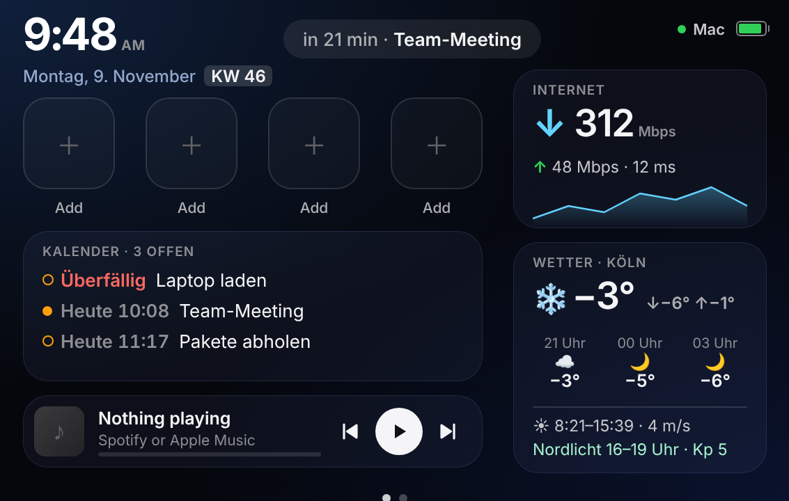
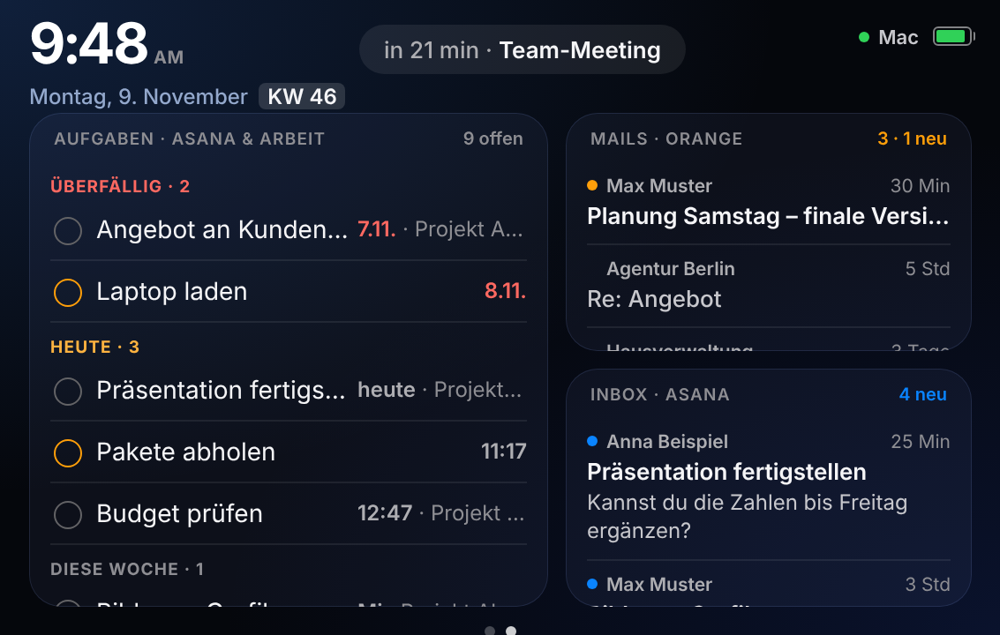

# Nordpult

Nordpult turns an iPad (or an old iPhone) into a control panel for your Mac: app keys, calendar with reminders, weather with a northern lights forecast, music controls, and on page 2 your Asana tasks, flagged mails and the Asana inbox.

The program runs on the Mac. The iPad only shows a web page on the same Wi-Fi, so nothing gets installed on it.

| Page 1 | Page 2 |
| --- | --- |
|  |  |

The interface is in German.

## Requirements

- Mac with macOS 14 (Sonoma) or later
- Apple's developer tools, once in Terminal: `xcode-select --install`
- iPad or iPhone on the same Wi-Fi

## Installation

1. Click **Code → Download ZIP** at the top of this page and unzip the file in Downloads.
2. Open Terminal and run (adjust the folder name if needed):
   ```bash
   cd ~/Downloads/nordpult-main && bash nordpult-installieren.sh
   ```
3. Answer the questions: weather location, calendars, look (`work`, `privat` or empty), optionally Asana.
4. Open the link shown at the end (`http://192.168.x.x:8045/#k=…`) in Safari on the iPad and save it via **Share → Add to Home Screen**.

From then on, Nordpult starts automatically every time you log in. On first launch, macOS asks for access to Calendar, Reminders and control of Mail and Music: click "Allow" each time.

**Several user accounts on one Mac?** Use `bash nordpult-mehrere-konten.sh` instead of `nordpult-installieren.sh`, then run it once in every other account with `bash /Users/Shared/Nordpult/nordpult-mehrere-konten.sh`. Nordpult then follows you when you switch accounts, and the iPad link stays the same.

## Usage

| Area | How to use it |
| --- | --- |
| App keys | Tap to open the app on the Mac, hold to change it |
| Calendar | Tap to open Calendar, tap a reminder to jump to page 2 |
| Page 2 | Swipe left |
| Tasks and reminders | Tap to expand: Done, Open, Cancel |
| Mails (look `work`) | Inbox mails with an orange flag in Apple Mail, tap to open in Mail |
| Asana inbox | Tap = mark as read, hold = open in Asana |

Without Asana, reminders and mails, page 2 shows a detailed weather and northern lights page instead.

## Asana (optional)

In Asana: profile picture → Settings → Apps → Developer apps → create a new personal access token. Paste it when the installer asks for it. It is stored only on your own Mac in `~/.nordpult/asana-token`. **Never upload it to the repo or share it.**

## Change, update, remove

- Change settings: `bash ~/.nordpult/nordpult-installieren.sh`
- Update: download the new ZIP and repeat step 2 (pressing Enter keeps your current settings)
- Show the iPad link: `grep -m1 '#k=' ~/.nordpult/log.txt`
- Remove: `bash ~/.nordpult/nordpult-entfernen.sh`, then optionally `rm -rf ~/.nordpult`
- Troubleshooting: `tail -n 30 ~/.nordpult/log.txt`

Treat the iPad link like a password: anyone who has it and is on the same Wi-Fi can open apps on your Mac.

## Origin and license

Nordpult is based on [oldphonedeck](https://github.com/GLAUCOMA82/oldphonedeck) and, like the original, is released under the MIT license (see `LICENSE`). Personal project, no support or warranty. Weather data: MET Norway. Northern lights: NOAA SWPC.
